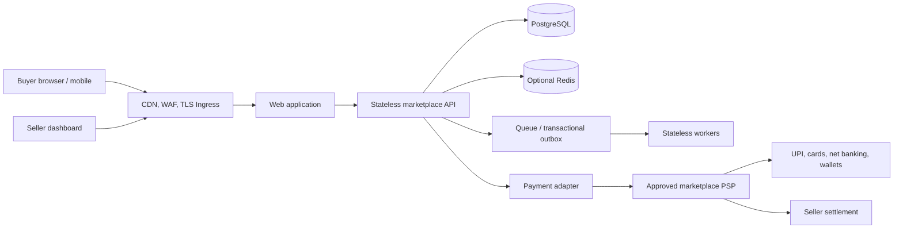

# Architecture and data model

## System overview

The API and workers should be horizontally scalable and keep no authoritative session, cart, payment, or order state in pod memory. Store durable state in PostgreSQL; use Redis only for disposable cache/short-lived coordination. Use a transactional outbox or an equivalent reliable event-publishing strategy so order commits and downstream work cannot silently diverge.

## Marketplace boundaries

- **Identity/access:** Buyers and sellers are users with roles; a user can hold both roles. Enforce seller ownership at every listing, inventory, and order endpoint.
- **Catalog:** Seller-scoped listings refer to a normalized category tree. Preserve snapshots on order items because product names, prices, and tax metadata can change later.
- **Orders:** A buyer checkout can contain items from multiple sellers. The parent order has seller suborders, allowing independent fulfillment and settlement.
- **Inventory:** Reserve stock transactionally with expiry and release on payment timeout/failure. Use conditional updates or row locks to prevent overselling.
- **Payments:** A provider adapter owns API credentials and provider-specific request/response mapping. The browser never supplies trusted paid state or commission amounts.
- **Commission ledger:** Persist the rate and integer-paise allocation used at checkout. Reconcile expected splits against PSP settlement events/reports; model refunds and reversals explicitly.

## Relational schema

The executable starter schema is [`../db/init/001_schema.sql`](../db/init/001_schema.sql). It uses PostgreSQL and integer paise amounts. The principal entities are:

| Table | Purpose |
|---|---|
| `users`, `user_roles` | Identity and buyer/seller/admin role membership |
| `seller_profiles` | Seller business information and opaque PSP account reference |
| `categories`, `category_closure` | Adjacency-list tree plus ancestor/descendant lookup table |
| `products`, `inventory` | Seller listings and stock/reserved counts |
| `orders`, `seller_orders`, `order_items` | Buyer checkout, seller fulfillment units, immutable purchase snapshots |
| `payments` | Provider order/payment references and idempotency key |
| `commission_splits` | Gross, rate, platform fee, seller net, transfer reference, settlement state |
| `payment_webhook_events` | Deduplicated provider events for audit and replay protection |

Category parent changes must be validated against cycles and update closure rows in a transaction. The initialization SQL inserts a sample `Computer Parts -> Storage -> NVMe SSDs` tree.

## Security and operational essentials

- Use a vetted OIDC/session or token-based identity system; enforce authorization in the API, not just in the frontend.
- Keep secrets in a secrets manager and expose them to pods through an approved integration. Rotate PSP credentials and restrict their permissions.
- Verify provider webhook signatures against the raw request bytes as required by that provider. Persist event IDs and reject duplicates; do not trust checkout redirects.
- Add rate limits, input validation, audit records, structured redacted logs, metrics, tracing, backups, restore tests, and alerting.
- Require TLS, least-privilege workload/cloud identities, network policies, non-root containers, resource requests/limits, and a tested incident/refund process.
- Confirm seller KYC, GST/invoicing, settlement, chargeback, and marketplace regulatory responsibilities with the PSP and qualified Indian legal/tax advisers.
